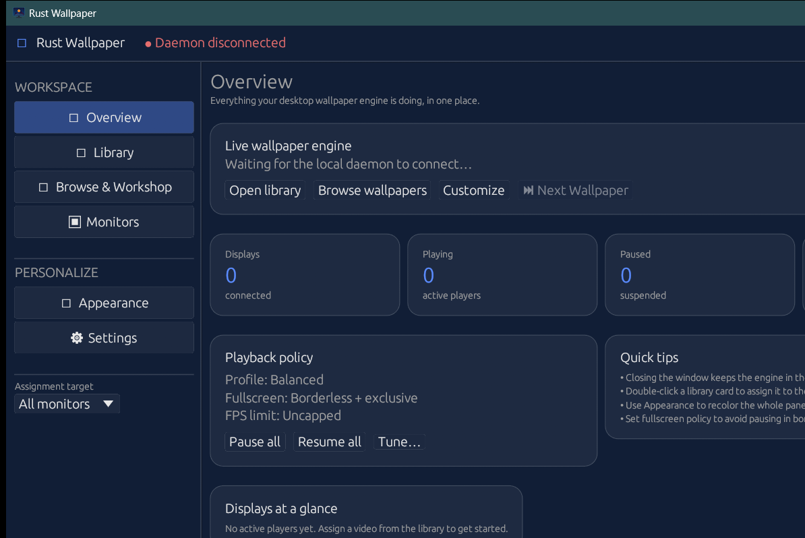
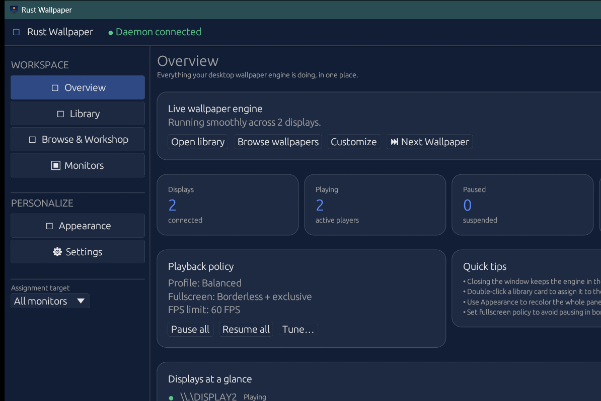
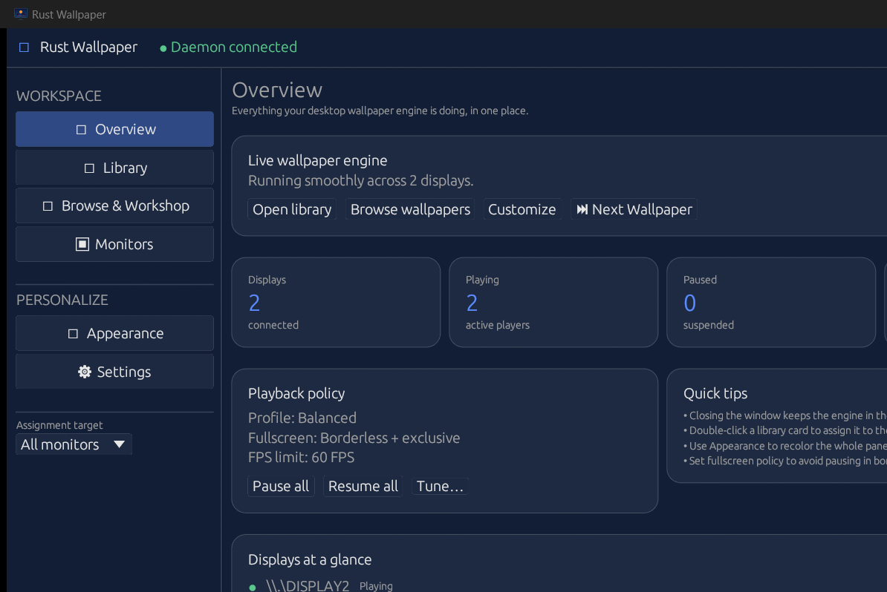
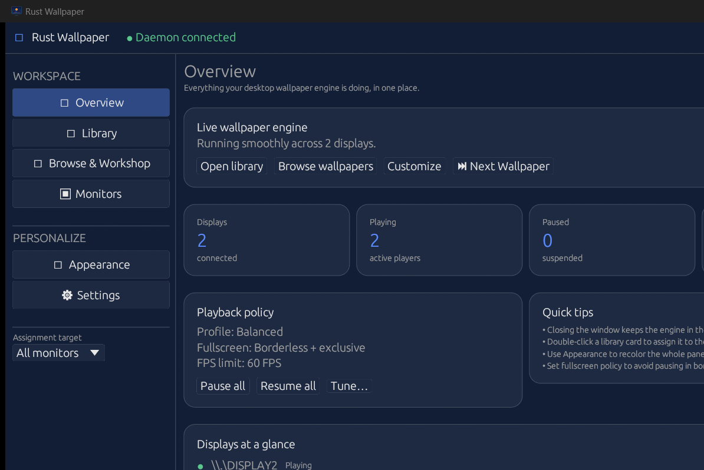
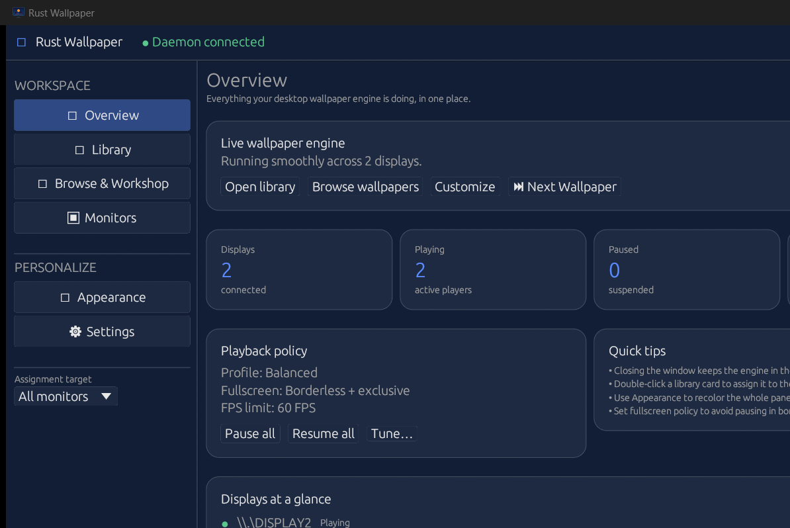

<div align="center">

# 🎬 RustWallpaper

### *Ultra-Low Overhead, Multi-Monitor Windows Live Wallpaper Engine written in pure Rust.*

[](https://www.rust-lang.org)
[](https://microsoft.com/windows)
[](https://mpv.io)
[](https://github.com/emilk/egui)
[]()
[](LICENSE)

<br/>

**RustWallpaper** is a high-performance Windows desktop wallpaper engine built from the ground up in Rust. It re-parents hardware-accelerated video streams directly behind Windows desktop icons using native Win32 `WorkerW` hooks. It delivers butter-smooth 60+ FPS video playback with near-zero CPU usage, comprehensive multi-monitor topology management, Wallpaper Engine-style performance tuning, and an IDM-style browser companion extension to capture and set wallpapers straight from the web.

[Home Page](https://hakimnouira.github.io/rust-wallpaper/) • [Installation Guide](https://hakimnouira.github.io/rust-wallpaper/install.html) • [Latest Release](https://github.com/hakimnouira/rust-wallpaper/releases/latest) • [Features](#-key-features) • [Screenshots](#-screenshots) • [Architecture](#-architecture) • [Quick Start](#-quick-start) • [Browser Extension](#-browser-companion-extension) • [Building](#-building-from-source)

---

</div>

## 🖼️ Screenshots

<div align="center">

### Modern Desktop Control Panel & Library


</div>

<br/>

| ◈ Browse & Curated Catalog | ▣ Display Topology & Assignment |
|:---:|:---:|
|  |  |

| ⚙️ Performance & Engine Tuning | ▦ Grid Library View |
|:---:|:---:|
|  |  |

---

## ✨ Key Features

### 🖥️ Native Win32 Desktop Re-Parenting
- Hooks seamlessly behind Windows desktop icons via `WorkerW` / `Progman` message pump injection.
- Preserves full icon interactivity, desktop selection rectangles, context menus, and multi-monitor coordinates.
- Automatic recovery when Windows Explorer restarts or monitor resolutions change.

### ⚡ Blazing Fast & Ultra-Low Resource Usage
- **Pure Rust backend:** Zero garbage collection pauses, instant startup (~40ms), and lean memory footprint.
- **Hardware Acceleration (DXVA2 / D3D11VA):** Offloads 100% of video decoding to your GPU, keeping CPU usage near 0%.
- Supports all modern formats: **MP4, WebM, MKV, AVI, MOV, and animated GIFs**.

### 🎛️ Wallpaper Engine-Style Performance Controls
- **Framerate Limiter:** Cap rendering at `15 FPS (Battery Saver)`, `24 FPS (Cinematic)`, `30 FPS (Balanced)`, `45 FPS`, `60 FPS (Ultra)`, or `Uncapped (Native)`.
- **Demuxer RAM Cache:** Allocate `32 MB (Low RAM)`, `64 MB (Standard)`, `128 MB (High Perf)`, or `256 MB (Ultra Seek)` for instant loop restarts without disk hits.
- **Video Scaling Filters:** Choose between `Bilinear (Low CPU)`, `Spline36 (Balanced / Sharp)`, or `EWA Lanczos (High Quality)`.
- **Intelligent Fullscreen Automation:** Auto-pauses video playback when 3D games or full-screen applications are focused, freeing up 100% GPU/CPU power.
- **System Event Awareness:** Automatically pauses on Windows Lock (`Win+L`), display sleep, or system suspend.

### 🌐 Browser Companion Extension (Chrome, Edge, Brave)
- Real-time media sniffer for **Pinterest, TikTok, Instagram, Reddit, YouTube, and Wallhaven**.
- Floating **"Set as Wallpaper"** badge appears directly over detected web videos.
- Communicates directly with the local engine via a high-speed loopback HTTP API on `127.0.0.1:24242`.

### 🔄 Rotation Playlists & Global Hotkeys
- **Auto-Cycle Playlists:** Automatically rotates desktop wallpapers on configurable intervals (`1m`, `5m`, `15m`, `30m`, `1h`).
- **Global Hotkeys:**
  - `Alt + W` — Instantly skip to the Next Wallpaper.
  - `Alt + M` — Master Audio Mute toggle.
- **Independent Audio:** Per-monitor volume controls and global master volume sliders.

---

## 🏛️ Architecture

RustWallpaper follows a strictly decoupled, service-oriented client/server architecture connected by versioned Win32 Named Pipes:

```mermaid
graph TD
    subgraph Browser Integration
        Ext[Chrome / Brave Extension] -->|HTTP REST API :24242| WebBridge[Web API Bridge]
    end

    subgraph Client Application
        UI[wallpaper-ui.exe\nModern egui GUI Panel] <-->|Named Pipe IPC| Pipe[\\.\\pipe\\rust-wallpaper-ipc]
        Tray[System Tray Icon\nGlobal Hotkeys] --> UI
    end

    subgraph Background Engine
        WebBridge --> Daemon
        Pipe <--> Daemon[wallpaper-daemon.exe\nRuntime Supervisor]
        Daemon --> DB[(SQLite Library\nlibrary.db)]
        Daemon --> EvWatcher[Win32 Event Listener\nLock / Sleep / Fullscreen]
        Daemon --> Topology[Monitor Lifecycle Manager]
        Topology --> Host[Desktop Host\nWorkerW / Progman Hooks]
        Topology --> MPV[MPV Video Players\nChild Subprocesses / IPC]
    end

    Host -.-> Screen((Desktop Background))
    MPV -.-> Screen
```

### Workspace Crates

| Crate / App | Type | Description |
|:---|:---:|:---|
| [`wallpaper-daemon`](apps/wallpaper-daemon) | Binary | Core background supervisor, Win32 window re-parenting, monitor lifecycle, and IPC server. |
| [`wallpaper-ui`](apps/wallpaper-ui) | Binary | Hardware-accelerated egui control panel, library browser, and system tray integration. |
| [`wallpaper-installer`](apps/wallpaper-installer) | Binary | High-speed, dependency-free Win32 setup wizard with clean uninstall support. |
| [`wallpaper-core`](crates/wallpaper-core) | Library | Domain models, SQLite database abstraction, media decoders, and online scrapers. |
| [`wallpaper-windows`](crates/wallpaper-windows) | Library | Win32 API bindings, `WorkerW` discovery, MPV process supervision, and shortcut injection. |
| [`wallpaper-protocol`](crates/wallpaper-protocol) | Library | Zero-overhead, versioned request/response contract over Win32 Named Pipes. |
| [`extensions/chrome`](extensions/chrome) | Extension | Chromium Manifest V3 companion extension for one-click web video capturing. |

---

## 🚀 Quick Start

### Option 1: Pre-Built Release (Recommended)

1. Download the latest release package (`RustWallpaper-0.1.0-windows-x64.zip`) from [GitHub Releases](https://github.com/hakimnouira/rust-wallpaper/releases/latest).
2. Extract the archive and run **`RustWallpaper-Setup.exe`**.
3. Choose your installation directory (defaults to `%LOCALAPPDATA%\RustWallpaper`) and finish installation.
4. Launch **Rust Wallpaper** from your Start Menu or Desktop!

### Option 2: Portable Mode

Extract the archive and run `RustWallpaper.exe` directly. It runs self-contained without requiring system-wide registry modifications.

---

## 🌐 Browser Companion Extension

The companion extension enables one-click wallpaper setting from sites like Pinterest, TikTok, Reddit, and Wallhaven.

### 1-Click Setup in Brave, Chrome, or Edge:

1. Open the RustWallpaper control panel and navigate to **⚙️ Settings**.
2. Under **Browser Companion Integration**, click:
   - **`⚡ Auto-Configure Shortcuts`** — Automatically configures your browser shortcuts (Desktop & Taskbar) to auto-load the extension on launch.
   - Or click **`🚀 Launch Browser with Extension`** — Immediately launches your browser with the companion extension active.
3. Open any video on [Pinterest](https://pinterest.com) or [Wallhaven](https://wallhaven.cc) and click the **"Set as Wallpaper"** badge!

---

## 🛠️ Building from Source

### Prerequisites

- **Rust:** Stable toolchain 1.78+ (`rustup default stable`)
- **Windows:** Windows 10 or 11 (64-bit)
- **C++ Build Tools:** Visual Studio C++ Build Tools or MinGW-w64
- **MPV Binaries:** Extract `mpv.exe` and `mpv-2.dll` to `%USERPROFILE%\.mpv` or beside the binaries.

### Compilation

```powershell
# Clone the repository
git clone https://github.com/hakimnouira/rust-wallpaper.git
cd rust-wallpaper

# Compile in release mode with Link-Time Optimization (LTO)
cargo build --release --workspace

# Run daemon and UI
cargo run --release -p wallpaper-daemon
cargo run --release -p wallpaper-ui
```

### Automated Production Build & Packaging

To compile optimized binaries, strip symbols, bundle MPV, package the browser extension into `.crx`, and generate the setup executable:

```powershell
powershell -ExecutionPolicy Bypass -File .\scripts\build-production.ps1
```

All distribution artifacts are written to `dist/`.

---

## ⌨️ Keyboard Shortcuts & Controls

| Shortcut | Action | Scope |
|:---:|:---|:---:|
| <kbd>Alt</kbd> + <kbd>W</kbd> | Skip to **Next Wallpaper** in rotation | Global (System-wide) |
| <kbd>Alt</kbd> + <kbd>M</kbd> | Toggle **Master Audio Mute** | Global (System-wide) |
| <kbd>Esc</kbd> | Close control panel to System Tray | Active UI Window |
| <kbd>F5</kbd> | Refresh library & re-scan monitors | Active UI Window |

---

## ⚙️ Configuration & Data Storage

RustWallpaper stores persistent state in standards-compliant Windows directories:

- **Database & Settings:** `%LOCALAPPDATA%\RustWallpaper\library.db` (SQLite)
- **Thumbnails Cache:** `%LOCALAPPDATA%\RustWallpaper\thumbnails\`
- **Daily Diagnostic Logs:** `%LOCALAPPDATA%\RustWallpaper\logs\daemon.YYYY-MM-DD.log`
- **Companion Extension:** `%LOCALAPPDATA%\RustWallpaper\extension\`

---

## 📄 License

This project is dual-licensed under either of:

- **MIT License** ([LICENSE-MIT](LICENSE-MIT) or [http://opensource.org/licenses/MIT](http://opensource.org/licenses/MIT))
- **Apache License, Version 2.0** ([LICENSE-APACHE](LICENSE-APACHE) or [http://www.apache.org/licenses/LICENSE-2.0](http://www.apache.org/licenses/LICENSE-2.0))

at your option.

---

<div align="center">
<sub>Crafted with ❤️ in Rust for Windows enthusiasts.</sub>
</div>
