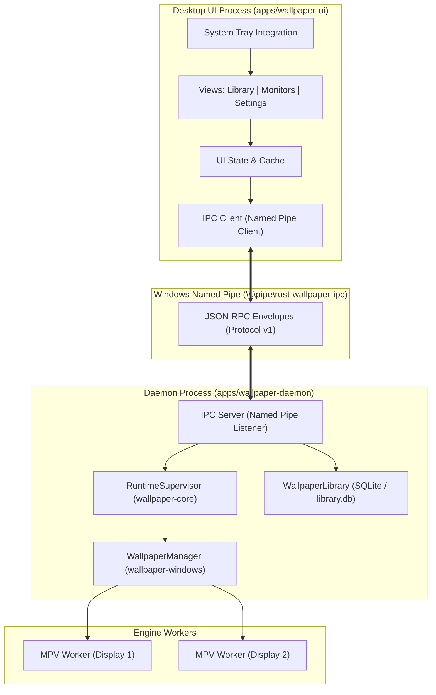
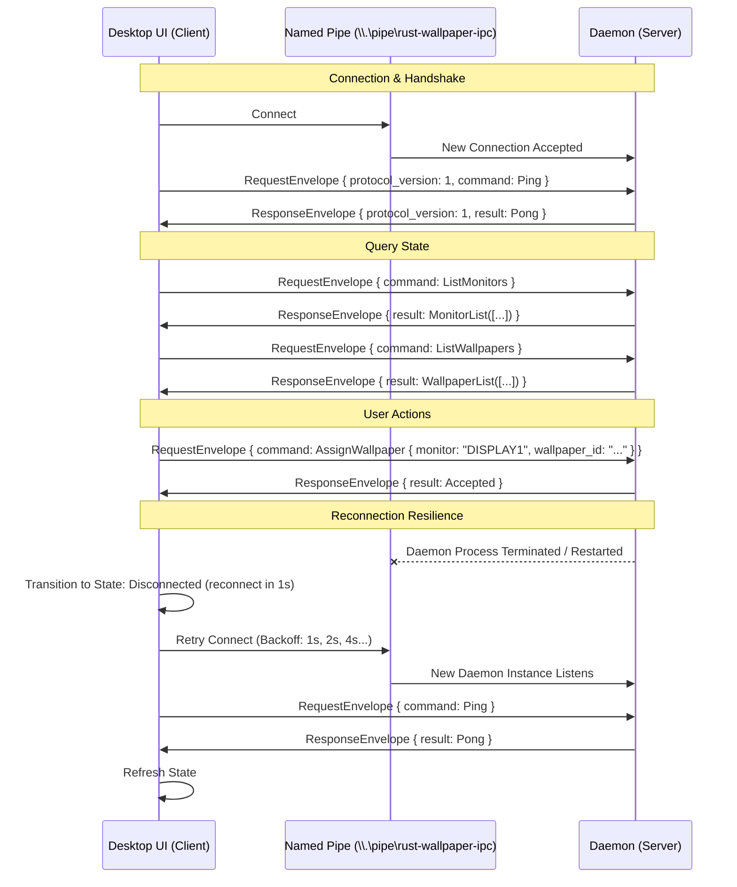

# Rust Wallpaper — Desktop Application & IPC Architecture Proposal

## 1. Executive Summary & Objective

The objective of the **Application & Product Engineering** workstream is to transform the headless Rust wallpaper daemon into an intuitive, responsive, and robust Windows desktop application without altering the underlying MPV video engine or duplicating runtime orchestration.

### Key Tenets
1. **Zero Runtime Duplication**: The UI never directly creates Win32 wallpaper windows or spawns MPV processes. All hardware orchestration remains centralized in `wallpaper-daemon` and `wallpaper-windows`.
2. **Daemon Crash Independence**: The desktop UI must gracefully handle daemon unavailability, timeouts, and daemon restarts with automatic background reconnection and state resynchronization.
3. **Decoupled Technology Stack**: The UI communicates strictly over `wallpaper-protocol` messages via Windows Named Pipes (`\\.\pipe\rust-wallpaper-ipc`).
4. **Pure Rust UI Experience**: Built using `eframe` / `egui` with `tray-icon` for native, lightweight, zero-dependency Windows desktop rendering, sub-10ms startup, and minimal memory overhead.

---

## 2. Component Architecture

### A. `crates/wallpaper-protocol` (Shared Contract)
The protocol serves as the strongly-typed contract between the daemon and any UI or CLI client.
- **Envelope Framing**: Line-delimited JSON with `protocol_version`, `request_id` (UUIDv4), and typed payloads.
- **Protocol Versioning**: Initial version `1`. Client and server validate protocol version on handshake (`Ping`/`Pong`). Mismatches return an actionable `Response::Error { code: ProtocolMismatch, ... }`.
- **Extended Commands**:
  - **Lifecycle & Health**: `Ping`, `GetStatus`, `QuitDaemon`
  - **Library**: `ListWallpapers`, `ImportWallpaper`, `RemoveWallpaper`, `UpdateWallpaperTags`, `ToggleFavorite`
  - **Monitors**: `ListMonitors`, `AssignWallpaper`, `UnassignWallpaper`
  - **Playback Control**: `Pause`, `Resume`, `Stop`, `SetVolume`, `SetMute`, `SetPlaybackConfig`
  - **Performance & Settings**: `GetSettings`, `UpdateSettings`, `SetProfile`

### B. `apps/wallpaper-daemon` IPC Server
- Spawns a background worker thread (`ipc-server`) that listens on `\\.\pipe\rust-wallpaper-ipc`.
- Uses native Windows Named Pipe APIs (`CreateNamedPipeW`, `ConnectNamedPipe`, `DisconnectNamedPipe`) or cross-thread mpsc channels.
- Dispatches commands directly to the shared `RuntimeSupervisor`, `WallpaperLibrary`, and `WallpaperManager`.
- Returns synchronous response envelopes within a bounded timeout.

### C. `apps/wallpaper-ui` Desktop Application
A dedicated desktop application executable structured as follows:
- **`app.rs`**: Main `eframe::App` implementation driving the event loop and tab views.
- **`ipc/`**: Background asynchronous IPC connection actor with connection state machine (`Connected`, `Connecting`, `Disconnected(reason)`), request-reply futures/channels, and automatic retry backoff.
- **`views/library.rs`**: Thumbnail gallery, search filtering, tag badges, favorite toggles, drag-and-drop or file picker import, and wallpaper removal.
- **`views/monitors.rs`**: Multi-monitor topology visualizer, per-display resolution/orientation display, wallpaper selector dropdown, and per-display playback toggles (volume, mute, pause/resume).
- **`views/settings.rs`**: Performance profiles (`Eco`, `Balanced`, `Performance`), Windows startup toggle (Registry `Run` key), hardware decoding options (`Auto`, `D3D11VA`, `DXVA2`, `Disabled`), and daemon status telemetry.
- **`tray.rs`**: System tray icon with context menu (Show Window, Pause All, Resume All, Mute All, Quit). Handles minimize-to-tray and close-to-tray.

---

## 3. IPC Design & Protocol Specification

### Named Pipe Details
- **Path**: `\\.\pipe\rust-wallpaper-ipc`
- **Security**: Reject remote clients. Local named-pipe access is governed by the process token's default pipe DACL in this first iteration; a strict per-user ACL and impersonation checks are release-hardening work.
- **Framing**: Line-delimited JSON (`\n`) for stream simplicity, human-inspectable debugging, and bounded, allocation-conscious streaming.

### Protocol Flow

---

## 4. UI/UX Feature Specifications

### 1. Wallpaper Library Management
- **Local SQLite Integration**: Interacts through daemon or shared `WallpaperLibrary` schema with extensions for `tags` and `is_favorite`.
- **Search & Filter**: Real-time text filtering by title, format, or tag. Quick-filter pills: `All`, `Favorites`, `Videos (MP4/WebM)`, `High Resolution`.
- **Importing**:
  - Native file picker via `rfd` (Rust File Dialog) supporting `.mp4`, `.webm`, `.mkv`, `.mov`.
  - Generates or caches video thumbnails for visual cards.
  - Custom title input and initial playback config (volume, loop, mute).
- **Wallpaper Card Actions**:
  - Click to select and preview metadata (resolution, duration, FPS, codec).
  - Quick assign button per monitor.
  - Delete with confirmation.

### 2. Monitor Management
- **Visual Display Map**: Scaled 2D visual representation of active desktop monitors based on screen coordinates $(x, y, w, h)$.
- **Monitor Metadata Badge**: Primary badge, display ID (`\\.\DISPLAY1`), resolution (e.g. `1920x1080`), and refresh rate.
- **Per-Monitor Controls**:
  - Active wallpaper card preview.
  - Dropdown to assign or change wallpaper from library.
  - Mute/Unmute and volume slider ($0 - 100\%$).
  - Pause/Resume toggle button reflecting active suspension flags.
  - Hardware decoder indicator (`d3d11va`, `dxva2`, software).

### 3. Application Settings & System Tray
- **Performance Profiles**:
  - **Eco**: Pauses video when any window is maximized or battery is on low power.
  - **Balanced**: Pauses video during active fullscreen applications/games, session lock, or display sleep.
  - **Performance**: Maximum framerate and quality, lowest latency.
- **Windows Startup**: Checkbox toggles `HKCU\Software\Microsoft\Windows\CurrentVersion\Run\RustWallpaper`.
- **System Tray**:
  - Double-click to restore/focus dashboard.
  - Right-click menu: `Open Dashboard`, `Pause All`, `Resume All`, `Mute All`, `Settings`, `Exit`.
  - Closing the main window minimizes to tray instead of quitting.

---

## 5. Implementation Roadmap & Milestones

| Stage | Focus Area | Deliverables |
| :--- | :--- | :--- |
| **Stage 1** | **Protocol & IPC Server** | Extend `wallpaper-protocol`, add Windows Named Pipe IPC server in `wallpaper-daemon`, create headless IPC client in `wallpaper-protocol`. |
| **Stage 2** | **Desktop UI Foundation** | Initialize `apps/wallpaper-ui` crate with `eframe`, modern dark theme, background IPC client thread, and connection status indicator. |
| **Stage 3** | **Monitor Management** | Implement Monitor visualizer tab, querying active displays and assignments via IPC, and per-monitor controls. |
| **Stage 4** | **Library Management** | Implement Library view with cards, thumbnail rendering, search/filter bar, tags, favorites, and file import dialog. |
| **Stage 5** | **Settings & Tray** | Implement system tray (`tray-icon`), minimize-to-tray behavior, Windows autostart toggle, and performance profile selector. |
| **Stage 6** | **Testing & Documentation** | Automated integration tests for IPC, timeout, and reconnection. User guide in `docs/` and walkthrough. |
